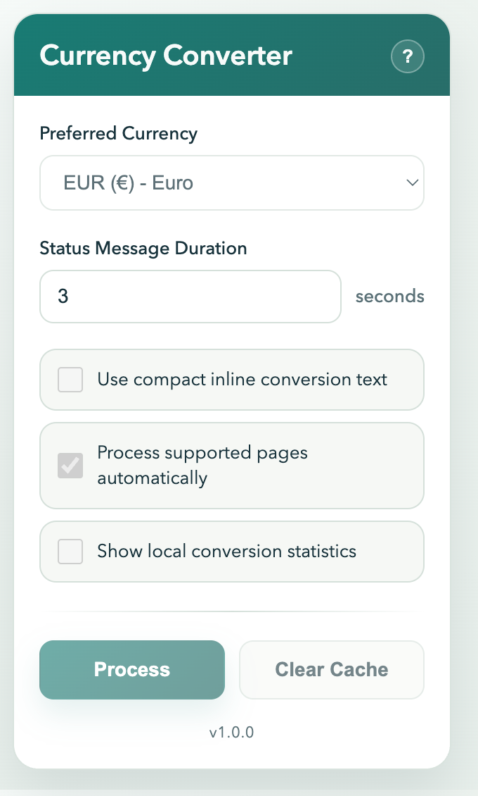
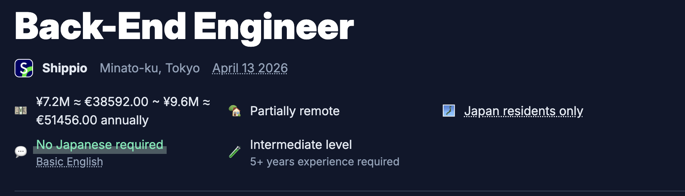

# Currency Converter Pro

Chrome Manifest V3 extension that detects prices in page text and shows inline conversions in the user's preferred currency.

The extension never sends page text to an external service.

This extension is not published on the Chrome Web Store yet, so for now it must be installed locally as an unpacked extension during development or personal use.

## Screenshots

<p>
  
</p>

Popup settings and manual actions.

<p>
  
</p>

Inline salary conversion on a real page.

## Project Status

This repository is public as a read-only reference implementation.

- Fork it if you want to adapt it for your own use.
- If you want to contribute directly to this repository, ask for access first.
- Commercial use is not allowed under the default license split.

## Public GitHub Setup

If you want to keep the repository public, forkable, and curated:

- Keep `LICENSE` and `CONTRIBUTING.md` in the repository.
- Treat forks as the supported path for independent development.
- Handle direct collaboration by granting contributor access selectively.

## Features

- Converts detected prices for `USD`, `EUR`, `GBP`, `JPY`, `CNY`, and `KRW`, including compact notation such as `¥7.2M`, full-width yen (`￥`), and Chinese yuan formats such as `CN¥100` and `99 元`
- Uses a 10-minute in-memory cache, persisted in `chrome.storage.local` after successful rate fetches
- Processes matching text nodes in batches, then watches added or edited page regions
- Leaves unsupported or ambiguous amounts unchanged instead of converting part of a number
- Preserves page edits when they replace text previously converted by the extension
- Tracks completed conversions in `chrome.storage.sync`; the service worker serializes updates from multiple tabs

## Privacy

- The content script does not call external APIs directly.
- Only exchange-rate requests are sent by `background.js`.
- No page text is sent to external services.
- User preferences and conversion stats are stored in `chrome.storage.sync`.
- Exchange-rate cache snapshots are stored in `chrome.storage.local`.
- The content script runs on top-level `http/https` documents, leaves embedded frames and editable fields alone, and does not use `innerHTML`.

## Project Structure

- `manifest.json`: extension wiring, permissions, popup, content script, service worker
- `content.js`: DOM scanning, price detection, and inline conversion
- `background.js`: exchange-rate fetches, cache persistence, and cross-context messages
- `popup.html` / `popup.js`: settings UI and manual actions
- `utils.js`: small shared helpers for error handling and storage wrappers

## Settings

- Preferred currency
- Message timeout
- Auto-process on page load
- Compact display mode
- Show conversion stats

## Installation

1. Clone or download this repository.
2. Open `chrome://extensions/`.
3. Enable Developer mode.
4. Click `Load unpacked`.
5. Select this project directory.

## Usage

1. Open the popup and choose your preferred currency.
2. Visit a page with visible prices.
3. Let the extension process automatically, or click `Process`.
4. Use `Clear Cache` to drop cached rates and restore converted text in the active page when it still matches the extension's output.

Example:

```text
Original: ¥1,500 for a coffee
Processed: ¥1,500 (≈ €9.27) for a coffee
```

The converted amount above is illustrative; it changes with the fetched rate.

The parser accepts decimal points and comma or space thousands groups, for example `$1,234.56` and `¥7.2M`. It leaves formats such as `€1.234,56` and `$1,23` unchanged because their separators are ambiguous. A bare `¥` is treated as JPY; use `CN¥`, `CNY`, or `RMB` to identify CNY. Prices split across separate DOM text nodes are outside the current detection scope.

## External APIs

The service worker retrieves rates from `https://api.frankfurter.dev/v1`.

If no valid rate is available for a detected currency, that amount remains unchanged. A manual `Process` request reports a failure when no requested rates can be obtained.

## Development

- Plain JavaScript only
- No bundler
- No transpiler
- No build step required

### Minimum validation

Run syntax checks on the runtime files:

```sh
node --check content.js
node --check background.js
node --check popup.js
node --check utils.js
```

If you change `manifest.json`, also validate that it remains valid JSON.

### Manual QA

Reload the unpacked extension in Chrome and verify:

1. The popup opens and saves settings.
2. `Process` works on the active tab.
3. Currency conversion still works on a static page with prices.
4. Currency conversion still works on a dynamic page.
5. Ambiguous formats remain unchanged, while `CN¥7.2M` converts only once.
6. No obvious duplicate rewrites or processing loops appear.
7. No errors appear in the page console or service-worker console.

## Chrome Extension References

These official Chrome guides cover the extension concepts most relevant to this project:

- [Get started with Chrome Extensions](https://developer.chrome.com/docs/extensions/get-started): build, load, and distribute an extension.
- [Manifest file format](https://developer.chrome.com/docs/extensions/reference/manifest): Manifest V3 wiring and supported configuration.
- [Extension service worker lifecycle](https://developer.chrome.com/docs/extensions/develop/concepts/service-workers/lifecycle): design background work around worker suspension and persisted state.
- [Content scripts](https://developer.chrome.com/docs/extensions/develop/concepts/content-scripts) and [message passing](https://developer.chrome.com/docs/extensions/develop/concepts/messaging): keep page DOM work and cross-context communication predictable.
- [Declare permissions](https://developer.chrome.com/docs/extensions/develop/concepts/declare-permissions): keep API and host access to the minimum required.
- [Debug extensions](https://developer.chrome.com/docs/extensions/get-started/tutorial/debug): inspect the manifest, service worker, popup, and content-script errors.

## License

See [LICENSE](LICENSE).
